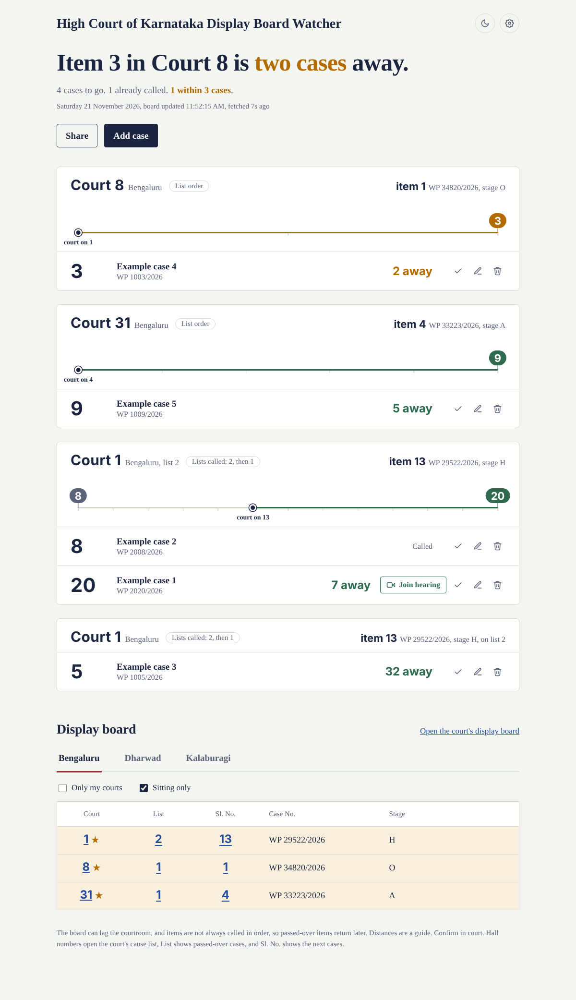
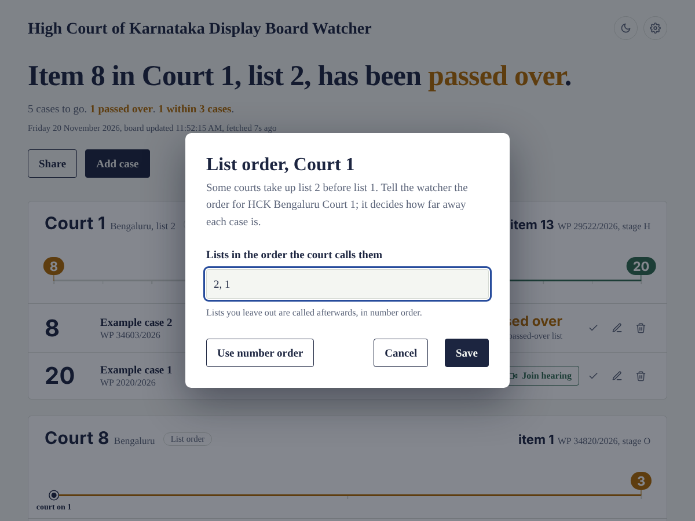
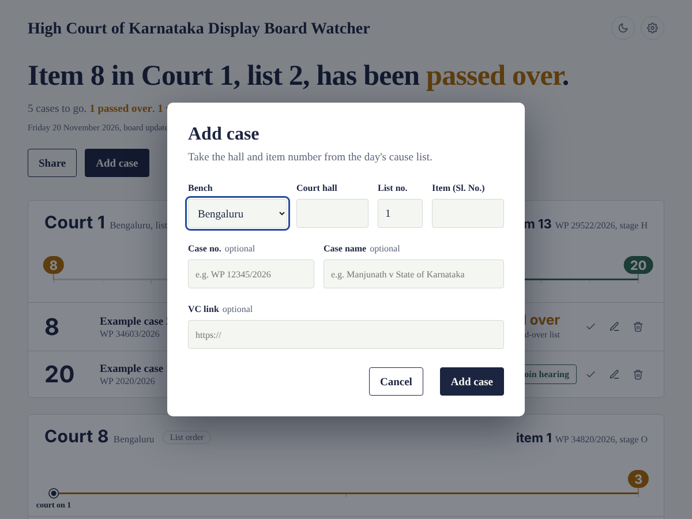
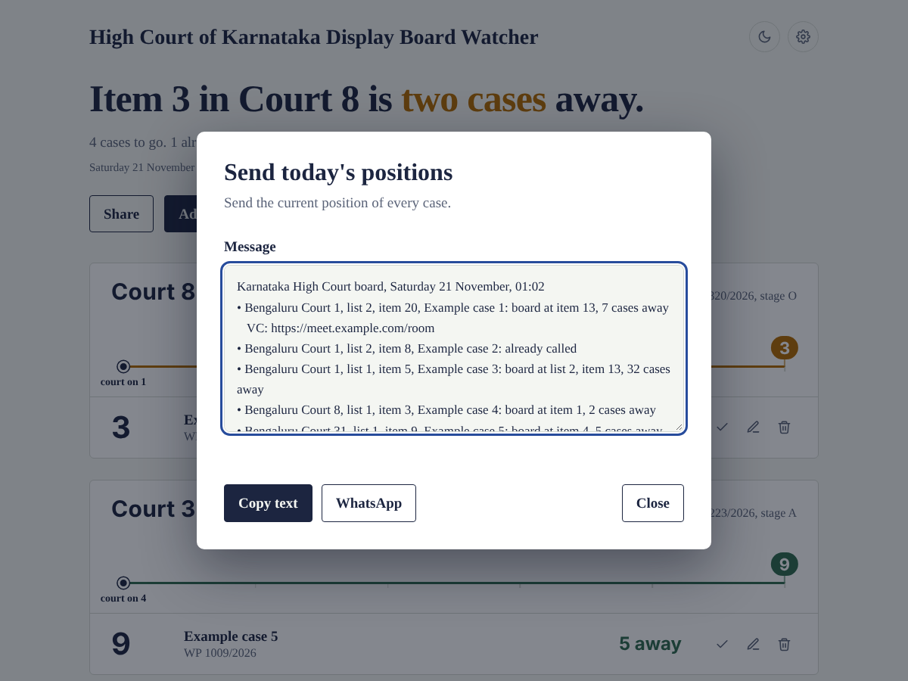
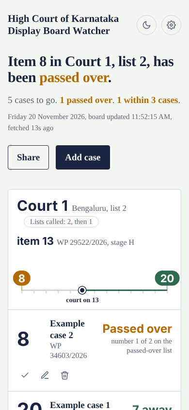

# High Court of Karnataka Display Board Watcher


**A personal display board watcher for the High Court of Karnataka: follow your cases
against the court's live board and see how many cases away each one is.**

**Runs on your own computer: `python3 watcher.py`, then open <http://localhost:8765>**

---

## Overview

Advocates and litigants at the High Court of Karnataka spend much of the day watching the
public display board, waiting for one item number to come up. The High Court of Karnataka
Display Board Watcher does the counting. You tell it the bench, court hall, list and item
number of each case you are following. It reads the court's live board, shows where each
court has reached, and says how many cases away each of your cases is. It covers all three
benches: Bengaluru, Dharwad and Kalaburagi.

This tool is intended for personal use and has not been endorsed by the High Court of
Karnataka. Please use it responsibly.

---

## Getting started

**Run it.**
1. Get the files. Download the repository with **Code**, then **Download ZIP**, and unzip
   it, or clone it with git. If you only want the program, download `watcher.py` and
   `index.html` and keep them together in one folder.
2. Install Python 3. Nothing else is needed, because the watcher uses only the standard
   library.
3. In that folder, run `python3 watcher.py`.
4. Open <http://localhost:8765> in a browser.

If the first read fails on a Mac with a certificate error, run "Install Certificates.command"
from your Python folder in Applications, then start the watcher again.

**Add your cases.**
1. Choose **Add case** and enter the bench, court hall, list number and item (Sl. No.)
   from the day's cause list.
2. Add a case number, a case name and a video conference link if you want them. All three
   are optional. If you leave the case number out, the watcher looks it up from the cause
   list.
3. Cases in the same hall and list share one ruler, so you can see how far the court is
   from each of them.
4. Item numbers belong to one day's cause list, so on the first visit of a new day the
   watcher shows yesterday's cases. Update the list or item for each case that has been
   listed again, untick the ones you no longer need, then choose **Save for today**, or
   choose **Clear all cases** to start clean. Settings are kept either way, and list
   orders are cleared because they can change from day to day.

**Read the screen.**
1. The headline names the case that needs attention first. The line under it counts the
   cases still to go, those already called and those passed over.
2. Each hall has a ruler. Your items are flags, and the court's current item is the pin.
   The coloured line from the pin runs to your next item.
3. Each case row shows its status: on now, a count of cases away, passed over or called.
   Use the row's buttons to join the video conference, mark a case done, edit it or delete
   it. A deleted case can be restored with Undo.
4. The **Display board** below mirrors the court's own board for the selected bench.

**Share and alerts.**
1. Choose **Share** to send the current position of every case by WhatsApp, the device's
   share sheet, or copy and paste. The message can be edited first.
2. In **Settings**, turn on a sound and notification, or a spoken alert, for when a case
   comes within your chosen number of cases or goes on.
3. Settings also has a switch to keep the screen on while the page is open.

---

## What the project does

The court's display board shows one row per court hall: the list being heard, the item
number and the case number now on. It does not say how far away your case is. This project
fills that gap.

**It follows your cases on the live board.** One background read of the court's board is
shared by every browser tab. The page refreshes from the watcher every 10 seconds, and the
watcher reads the court no faster than every 30 seconds. A case also counts as on now if
its case number appears in any hall on the board, not only the hall you entered.

**It counts cases away.** On the same list, the distance is your item number minus the
board's item number. A case is close when it is within the number of cases you choose,
three by default.

**It knows the court may take up the lists in a different order.** Courts sometimes call
list 2 before list 1. For each hall, you can set the order in which the lists are called.
The count of cases away then runs through the lists in that order.

**It tells passed over from called.** When the board has gone past your item, the watcher
checks the court's passed-over list for that hall. A case on that list is shown as passed
over, with its place on the list. A case that is not on it is shown as called.

**It fills in case numbers.** If you add a case without a case number, the watcher reads the
hall's cause list and uses the number listed for that list and item.

**It keeps what you need beside each case.** Each case can carry a name and a video
conference link, with a Join hearing button on its row.

**It lets you look at the whole board.** The Display board has a tab for each bench, a filter
for the halls where you have cases, and a filter for the halls that are sitting. Select a
hall number to open its cause list, a list number to see the cases passed over in that
hall, or an item number to see the next few cases.

### Parts of the page

| Part | What it is for |
| --- | --- |
| **Headline and summary** | The case that needs attention first, and the tally of the rest |
| **Hall cards** | One card per hall and list, with a ruler, the court's position and your cases |
| **List order** | The order in which the court calls the lists of one hall |
| **Display board** | The court's own board for each bench, with links to its cause list and passed-over cases |
| **Share** | A message with every case's position, for WhatsApp or copying |
| **Settings** | Light or dark theme, how close counts as close, how often the board is read, alerts and keeping the screen on |

### How to read the page

- Your cases, names, links and settings are stored in your own browser. They are never sent
  to a server.
- A hall that is not sitting, or has no session, is shown as such. It is never shown as a
  distance.
- The count is in cases, using the board's item numbers. Anything the court does outside
  that numbering is not counted.

Some limits matter when reading any status:

- **The board can lag the courtroom.** What the page shows is what the court's board shows.
  Always confirm in court.
- **Items are not always called in order.** Cases are passed over and return later, so a
  count of cases away is a guide and not a promise.
- **Connected cases are not counted.** Cases listed as connected with another case, such as
  item 1.1, are not separate items on the board. Across lists, the watcher counts the items
  from the cause list's highest item number, so the figure is approximate.
- **A list that is not in the cause list has no count.** If a list is called after the one
  the court is on and its length is not known, the status says so and gives no number.
- **The passed-over position is the court's list order.** It shows where the case stands on
  the hall's passed-over list, which covers every list in that hall.

---

## Understanding how a case's position is worked out

For each case, the watcher takes the first of these that applies.

1. **On now.** The case number appears on a sitting row anywhere on the bench's board.
2. **No board data.** The hall is missing, is not sitting today, or has no session. The
   status says so.
3. **Same list as the court.** The distance is the item number minus the board's item
   number. Zero means on now. A positive number is close or far, depending on your
   setting. A negative number means the board has gone past the item, and step 5 applies.
4. **A list the court has not reached.** Using the hall's list order, the distance is the
   cases left on the board's list, plus the full length of every list called in between,
   plus your item number. Without the cause list, the status reads that the list is called
   after the one the court is on.
5. **A list the court has already taken up.** If the case is on the hall's passed-over
   list, it is passed over, with its position on that list. If the case number is known and
   is not on the list, it is called. If the case number is not known yet, the status shows
   "Passed?" and how far the board is past your item.

**The first case in a list.** If the court is on that list, item 1 is on now and the count
runs down from it. If the court is on an earlier list, the distance is the cases left there,
plus any lists in between, plus one.

**The order of the lists.** With nothing set, lists are called in number order. Setting the
order for a hall, for example `2, 1`, makes list 2 first. Lists you leave out are called
afterwards, in number order. The setting is stored per hall, in your browser.

**How the two lookups are limited.** The passed-over list is read only while the board is
past one of your cases, at most once a minute. A cause list is read only when a case number
or a list length is needed, at most once every 30 minutes.

---

## Using it responsibly

The court's website asks automated programs not to fetch its display board page. This
project is meant for one person's own use, on their own computer, to follow their own cases.
It therefore reads the board in one shared background request, no faster than every 30
seconds, and fetches the other pages only when needed.

If you share or fork this project, keep it that way: do not run it as a public service, do
not lower the read interval, and do not collect the court's data. The board is a public
convenience for people in the courtroom, and this tool is a way of reading it more easily.

---

## Screenshots

**Your cases against the live board**

<p align="center">
  
</p>

**Setting the order in which a court calls its lists**

<p align="center">
  
</p>

**Adding a case**

<p align="center">
  
</p>

**Sharing today's positions**

<p align="center">
  
</p>

**Phone-sized layout**

<p align="center">
  
</p>

The screenshots use made-up example cases and a sample board.

---

## What is in this repository

```text
court_watcher/
├── watcher.py      # local server: reads the court's pages and serves the page
├── index.html      # the whole interface, in one file
├── LICENSE
├── README.md
└── screenshots/
```

The watcher listens on this computer only (`127.0.0.1`, port 8765 by default). Use
`--port` to choose another port.

---

## Author

Aditya Rajiv Ratnam

---

## License

Released under the [MIT License](LICENSE).
